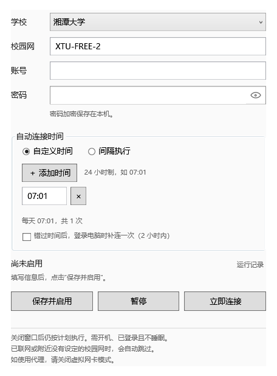

# CampusLuma · 微光校园

一个简单的 Windows 校园网自动连接窗口。设好时间，先连接校园 Wi-Fi；已经能上网就结束，未认证才填写账号、密码并登录。

[](https://github.com/Orangaigai/CampusLuma/actions/workflows/ci.yml)
[](LICENSE)
[](#运行要求)

**当前为预览版。湘潭大学已完成真实未认证状态下的自动恢复验收；其他学校仍是默认关闭的原型，不代表已经可用。** 本项目由个人维护，与学校及认证系统厂商无隶属关系。

[下载与版本说明](https://github.com/Orangaigai/CampusLuma/releases) · [使用指南](docs/USAGE.md) · [常见问题](docs/FAQ.md) · [学校支持范围](docs/SCHOOLS.md) · [参与开发](CONTRIBUTING.md)



## 能做什么

- 自定义多个时间，或设置开始、结束时间和执行间隔，使用 24 小时制。
- 到点优先连接设置的校园 Wi-Fi，即使当时连着热点；目标 Wi-Fi 不在附近时保留当前网络并退出。
- 先检查外网；无感认证已生效就跳过密码登录，否则获取本次认证入口再认证。
- 修改时间不必重填密码；密码用 Windows 当前用户的 DPAPI 加密保存。
- 关闭窗口后由 Windows 任务计划程序执行，无需常驻扫描。
- 查看最近 100 次运行记录，导出经过字段白名单处理的反馈。
- 可选“错过时间后，登录电脑时补连一次”：只补最近两小时内尚未执行的最近时段，默认关闭。

## 快速开始

### 下载运行

1. 从 [Releases](https://github.com/Orangaigai/CampusLuma/releases) 下载 `windows-x64.zip`，完整解压到自己可写的固定目录。GitHub 的 **Source code** 是源码，需要自行构建。
2. 打开 `CampusLuma.exe` 或 `启动微光校园.cmd`，保留整个文件夹。
3. 选择学校，填写实际 Wi-Fi 名称、自己的账号和密码。湘大默认 `XTU-FREE-2`；它是 Wi-Fi 名称，不是认证网址。
4. 在校园内先点“立即连接”，确认浏览器和远控实际可用，再设置时间并点“保存并启用”。**首次打开不会自动创建任务。**
5. 不再使用时点“暂停”。移动目录前先暂停，移动后重新保存；[完整步骤](docs/USAGE.md)。

预览包不包含你的设置或账号，不捆绑 Edge；程序尚未进行代码签名。预览包与已有正式安装使用不同的数据和任务名称，升级、并行使用前请阅读 [版本与数据](docs/USAGE.md#版本与数据)。

### 从源码运行

需要 Windows 10/11 x64、.NET Framework 4.8、Windows PowerShell 5.1、Node.js 24 LTS 和 Microsoft Edge。Node 引擎最低要求为 20，当前发布流程使用 24。

```powershell
git clone https://github.com/Orangaigai/CampusLuma.git
cd CampusLuma
npm.cmd --prefix engine ci
powershell.exe -NoProfile -ExecutionPolicy Bypass -File .\build.ps1
.\CampusLuma.exe
```

不需要安装 Python、Electron 或启动本地网站。依赖版本由 `engine/package-lock.json` 锁定；首次安装需要网络。

## 时间怎样生效

| 模式 | 设置示例 | 实际检查时刻 |
| --- | --- | --- |
| 自定义 | `07:01`、`12:30`、`18:00` | 每天分别检查一次 |
| 间隔 | `07:01` 开始，每 `2` 小时，`23:00` 结束 | `07:01`、`09:01` … `21:01` |
| 跨午夜 | `22:00` 开始，每 `2` 小时，`02:00` 结束 | 每天 `22:00`、`00:00`、`02:00` |

保存后会创建真实的 Windows 计划任务，窗口从任务中读取已启用时间。每次到点执行一轮；没有后台每两分钟轮询。`07:01` 是湘大使用场景的示例，学校允许认证的时间可能变化，应按本校实际情况设置。

## 学校支持

| 学校 / 范围 | 状态 | 默认可选 |
| --- | --- | --- |
| 湘潭大学 | 已完成密码认证、外网恢复及 Windows 定时触发的真实验收 | 是 |
| 陕西师范大学长安校区 | JSP 表单原型，已做隔离测试，待校内验收 | 否 |
| 湖南科技大学、湖南师范大学 | Dr.COM 原型，已做隔离测试，待校内验收 | 否 |
| 成信大航空港、四川工科、燕大、电子科大清水河电信、齐鲁工大、大工盘锦、闽南师范圆山 | SAM / 浏览器规则原型，各有适用范围及缺口 | 否 |
| 湖南警察学院 | 资料调研阶段 | 否 |

**修改 Wi-Fi 名称或填一个认证网址，不会自动适配另一所学校。** 网关、校区、运营商、页面版本和登录协议都可能不同；详见 [逐校状态与依据](docs/SCHOOLS.md) 和 [适配指南](docs/ADAPTERS.md)。欢迎提交脱敏的学校资料和校内验收结果。

## 运行要求

- 电脑开机、已登录 Windows，并能连接目标 Wi-Fi；锁屏、熄屏可以，关机和注销后不能执行。
- 任务请求 Windows 唤醒，但能否唤醒取决于电源设置与硬件。需要稳定远控时，建议接电并设为不自动睡眠。
- 后台认证尽量直连并绕过系统代理，**不自动关闭或恢复 VPN/TUN**。全局加 TUN、路由接管等组合不保证可用，首次验收请关闭 TUN。
- 目前面向 Wi-Fi。网线、多物理网卡路由绑定、任意语言的 `netsh` 输出和任意学校门户不在承诺范围内。
- 学校维护、欠费、账号停用、认证限时、复杂验证码及页面改版仍可能造成失败；明确的账号拒绝会暂停后续密码尝试。

## 隐私与反馈

设置和凭据保存在本机；不上传到项目服务器，没有内置遥测。认证时账号密码会发给对应学校系统，外网探测会访问公共连通性地址；本机加密不改变学校 HTTP 门户的传输方式。[详细说明](docs/PRIVACY.md)

报告故障优先使用“运行记录 → 导出反馈”，并在上传前查看内容。不要公开密码、完整认证链接、Cookie、HAR、浏览器存储或个人配置目录。

- [报告问题](https://github.com/Orangaigai/CampusLuma/issues/new/choose)
- [提交学校适配](docs/ADAPTERS.md)
- [私下报告安全问题](SECURITY.md)

## 开发、测试与路线

```powershell
# 隔离测试：虚构账号、模拟网络命令，不创建真实联网计划
powershell.exe -NoProfile -ExecutionPolicy Bypass -File .\tests\run-offline.ps1

# 本机完整集成验证：会创建并清理临时测试任务，需要桌面会话
powershell.exe -NoProfile -ExecutionPolicy Bypass -File .\tests\run-tests.ps1
```

GitHub Actions 运行构建与隔离测试；绿色 CI 不等于某校已通过真实认证。[验证范围](VERIFICATION.md) · [架构](docs/ARCHITECTURE.md) · [更新记录](CHANGELOG.md)

后续优先完善湘大的安装升级与故障定位，再逐校验收陕西师大、湖南科大、湖南师大；暂不承诺“万能认证”。

## 许可证与参考

本项目使用 [MIT License](LICENSE)。运行依赖遵循各自许可证，见 [THIRD-PARTY.md](THIRD-PARTY.md)。参考项目及具体设计取舍见 [调研记录](docs/REFERENCES.md)，未复制无许可证项目的实现代码。
