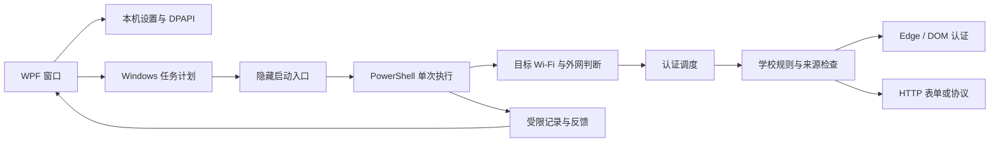

# 架构

## 目录

| 目录 | 职责 |
| --- | --- |
| `src/`、`ui/` | .NET Framework / WPF 窗口、时间、存储、规则验证、运行记录与补连 |
| `scripts/` | 隐藏入口、单次任务、计划任务事务与查看 |
| `engine/` | 无线连接、连通性、Node 认证核心、入口及 DOM / HTTP 协议处理 |
| `adapters/` | 每所学校的公开规则、来源和证据 |
| `tests/`、`engine/tests/` | C#、PowerShell、浏览器与协议样例测试 |
| `tools/` | 源码导出、发布打包、公开文件检查 |

## 边界

调度与认证分离。一次调度只运行一轮，不持久扫描；任务和窗口都指向同一个已解析数据目录。任务使用当前已登录用户，不保存 Windows 登录密码，不自动提权。

认证先判断当前连接和外网，再选择学校规则。需要从本轮网关跳转取得终端参数，不能把固定 URL、管理中心登录或仅有“登录成功”文字当作恢复网络。完成后还需外网探测。

浏览器通过受信来源和学校 DOM 选择器定位控件；HTTP 流程验证表单来源和当前版本。来源、版本或服务不明确时停止。浏览器初始化可在提交前有限重试；明确账号拒绝后暂停密码尝试。

运行结果按本次调用返回，不读取旧日志末行猜测；界面结合 Windows 任务状态识别过期结果。日志反馈从允许字段重新构造。可选登录后补连通过互斥和内部执行回执，避免重复执行同一个计划时段。

目前没有普遍的物理网卡流量绑定，也不接管代理 / VPN；不能从读取了正确 SSID 推断所有流量一定走该网卡。
