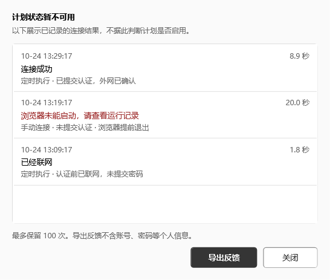

# 界面设计

2026-10-24，适用于 0.1.0-preview.2。目标是一个简单、易读的 Windows 小窗口。

## 整体结构

从上往下依次是连接信息、自动连接时间、当前状态；底部固定“保存并启用 / 暂停 / 立即连接”。用户按填写和执行的顺序操作，不需要切换多个设置页。

- 主窗口默认 480 × 680，采用系统窗口边框，可调整大小。
- 表单左右留白 24，标签与输入框统一对齐，常规输入高 34。
- 中性灰与白色区分内容层级，主要操作用深灰；失败文字用深红，并同时说明原因。
- 只把说明性文字缩小；字段名称、输入内容、操作按钮保持清楚。
- 校园网一栏填写实际 Wi-Fi 名称，学校需要运营商时才显示对应选择。

## 时间与操作

时间输入和添加按钮相邻，删除按钮贴近对应时间。24 小时制在分区标题旁说明。间隔模式直接显示实际执行时间，跨午夜按生成的时刻预览；小数间隔和跨天解释也可在输入框的提示中查看。

时间很多时，只滚动时间列表；窗口较小时，表单整体也可滚动，三个主要按钮始终可见。长错误信息自动换行，提示不占用按钮区域。没有提示时不预留一块空白错误栏。

保存和连接过程中显示“保存中…”或“连接中…”，避免重复操作。密码显示按钮可反复切换；窗口失去激活状态后隐藏明文，并保留已输入的密码。

## 运行记录

每条记录按时间与耗时、结果、执行方式和认证方式排列。只有失败结果使用红色。将“原本已联网，未提交密码”和“提交认证后确认外网可用”写清楚，避免把无感认证与程序登录混淆。

系统任务返回码放在可展开的“任务详情”里。没有记录时说明首次执行后会显示什么。选中一条记录可按 Ctrl+C 复制；反馈仍通过现有字段白名单导出。

## 参考与实际取舍

以下是阅读项目及问题反馈后的设计取舍，不代表相关项目或报告者认可 CampusLuma；没有引入其 UI 框架，也没有复制实现代码。

| 参考 | 观察与反馈 | 在本项目中的处理 |
| --- | --- | --- |
| [ModernWpf](https://github.com/Kinnara/ModernWpf) | 原生 WPF 控件可以通过样式获得一致的外观 | 统一输入、按钮、选择器与列表的样式，继续使用现有 WPF 控件 |
| [Flow Launcher 的双屏对齐反馈 #2910](https://github.com/Flow-Launcher/Flow.Launcher/issues/2910) | 用户报告不同缩放的双屏出现窗口定位偏移 | 按系统工作区限制初始尺寸、允许滚动；不把离屏截图测试称为真实多屏验收 |
| [LocalSend 的设置无障碍反馈 #3296](https://github.com/localsend/localsend/issues/3296) | 用户报告设置控件缺少有意义的名称，读屏操作受阻 | 为输入项和图标按钮命名，保留原生控件交互，验证下拉的 UI Automation 行为 |
| [Microsoft 的文字可访问性说明](https://learn.microsoft.com/en-us/windows/apps/design/accessibility/accessible-text-requirements) | 普通文字需要足够对比度；静态文字不应假装是编辑框 | 次要文字仍保持可读，说明使用 TextBlock；不依靠颜色单独表达错误 |

这些都是具体的项目样例或个别问题报告，不是对所有用户偏好的统计结论。界面最终按本项目“少字段、少页面、少装饰”的使用目标取舍。

## 验证范围

22 项原生窗口检查覆盖默认 / 缩小窗口、多个时间、长错误、下拉展开、密码隐藏、历史与旧结果回退等。另有原生交互回归覆盖添加与保存时间、保存失败回退、学校与运营商切换、记录更新。

生成的 150% / 200% 图片是渲染检查，不等于系统 DPI 变化；尚未完成实际混合缩放双屏、所有高对比度主题和 Narrator / NVDA 的端到端测试。详见 [验证范围](../VERIFICATION.md)。
