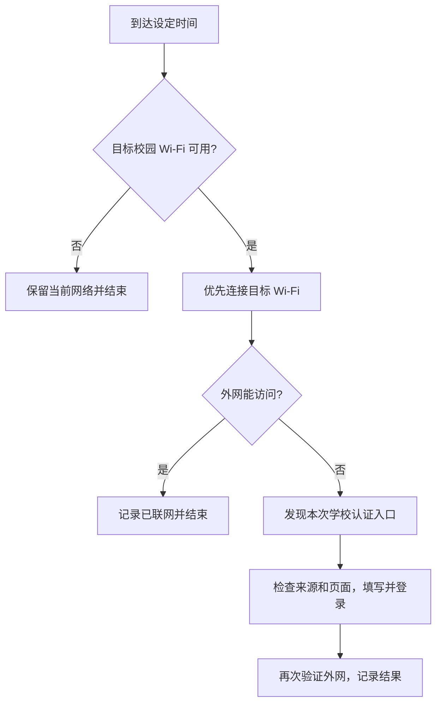

# 使用指南

## 首次使用

完整解压 Releases 的 Windows x64 包，放在自己可写、以后不随意移动的位置，打开 `CampusLuma.exe`。它依赖旁边的 ui、scripts、engine、adapters、runtime，不能只复制 exe。

1. **学校**：普通预览版目前只有湘潭大学。其他学校有规则文件，不代表已开放。
2. **校园网**：填写 Windows Wi-Fi 列表显示的名称，大小写与空格保持一致。需要先在 Windows 保存过这个 Wi-Fi 的连接配置；这不是网页地址。
3. **账号、密码**：填写本人已开通的校园网账号。小眼睛显示本次输入；保存后密码框清空，原密码仍加密保存。
4. **自动连接时间**：用 `HH:mm`，例如 `07:01`；午夜写 `00:00`，不写 `24:00`。点“＋ 添加时间”后可直接编辑新时间，点“×”删除。
5. 校内先“立即连接”，确认真正能上网，再“保存并启用”。它会替换本版本自己的计划，并显示 Windows 实际启用的时刻。

已有密码时，只改时间不必重新输入。修改学校或账号需要重填；填写正确密码后保存也可清除先前的账号拒绝暂停状态。

## 间隔执行

设置开始时间、间隔小时数和结束时间。允许 5 分钟到 24 小时，精确到分钟，`0.5` 小时表示半小时。结束时间只有恰好落在间隔上才执行；开始与结束相同表示每天一次。跨午夜会展开成一天中的实际时刻。

编辑区是预览；点击“保存并启用”成功后才改变系统任务。关闭窗口不取消计划，点“暂停”才停用。需要永久删除时，先暂停，然后在 Windows“任务计划程序”中删除本版本前缀的任务，再移除程序目录；可选删除自己的本地数据。

## 到点后的流程

无感认证成功时，程序不再提交密码；失败时才继续认证。不强制下线设备，不反复试错密码，不持续扫描校园网。

## 电源与远控

需要电脑开机并已登录 Windows；锁屏与熄屏不妨碍执行，关机或注销不能运行。任务会请求唤醒电脑，但系统电源策略、现代待机和硬件可能阻止唤醒。需要早上稳定远控时建议接电，并设置“睡眠：从不”；是否合盖运行请依据电脑厂商散热说明设置。

“错过时间后，登录电脑时补连一次”默认关闭。开启后仅在登录 Windows 时检查最近两小时内未执行的最近时段，不会自动开机、自动登录，也不会因为认证失败反复重试。完整重启后恢复的校内实测仍待完成。

## 代理与 TUN

程序的认证路径绕过系统代理设置；TUN 会接管系统路由，不能据此保证绕过。程序不检测或退出 Clash 等软件。首次校内验收请关闭 TUN；如果认证页受影响，也先暂停代理。

## 版本与数据

| 类型 | 本地数据默认位置 | 计划任务前缀 |
| --- | --- | --- |
| 本仓库 / 当前预览包，带 `development.mode` | `%LOCALAPPDATA%\CampusLuma-Dev` | `CampusLuma Development` |
| 历史日用安装，不带该标记 | `%LOCALAPPDATA%\CampusLuma` | `CampusLuma Reconnect` |
| 独立学校试验包 | `%LOCALAPPDATA%\CampusLuma-<学校>-Trial` 或包内指定目录 | `CampusLuma Trial-<学校>` |

预览包保留隔离标记，避免覆盖已有日用安装。同一前缀的多个副本共用数据和任务，**不要同时启用两个版本的计划**。升级前先暂停旧副本，再解压新包、打开并重新“保存并启用”。如果旧版运行良好，先保留备份，不必立即替换。

系统可能重定向 AppData。根目录的 `data-location.json` 记录当前用户与实际位置，使窗口和后台任务一致；不要上传它。DPAPI 凭据不能直接搬到另一台电脑或另一个 Windows 用户下使用。

## 失败时怎样反馈

打开“运行记录”，查看时间、是否提交认证和结果，再“导出反馈”。提交 [故障表单](https://github.com/Orangaigai/CampusLuma/issues/new/choose) 时说明是本机打不开网页，还是仅手机远控显示离线；两者原因可能不同。不要先发送密码或原始日志。
